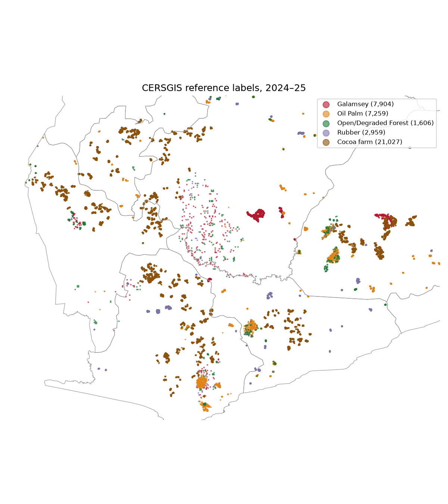
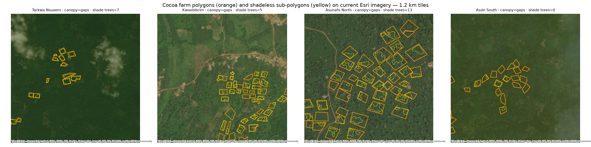

# cocoa-vs-forest

Distinguishing cocoa plantations from forest in Ghana at the EUDR cutoff date (31 Dec 2020) by fine-tuning [OlmoEarth](https://github.com/allenai/olmoearth_pretrain) on Sentinel-1/Sentinel-2 time series.

CSE 580: Computing for Social Good, University of Washington, Autumn 2026. Kyvalya Reddy and Ben Bioren.

## Motivation

The EU Deforestation Regulation (EUDR) bars imports of commodities such as cocoa grown on land deforested after 2020. Existing 2020 forest maps (e.g. JRC GFC2020) often misclassify shaded cocoa as forest in West Africa. This project tests whether OlmoEarth's learned representations can separate the two and serve as a scalable screening tool for EUDR compliance.

## Plan

1. **Labels.** Build cocoa / forest / other labels for Ghana from existing maps plus a hand-labeled, spatially held-out test set.
2. **Baseline.** Train a linear probe / kNN on frozen OlmoEarth embeddings of 2020 imagery.
3. **Fine-tune.** Fine-tune OlmoEarth with a segmentation head via [rslearn](https://github.com/allenai/rslearn).
4. **Evaluate.** Compare against GFC2020 and existing cocoa maps, with emphasis on shaded cocoa.

## Data status

Labels are built from open data; see [`scripts/README.md`](scripts/README.md) for the pipeline, counts, caveats and licences.

- **Cocoa:** 21,027 field-mapped farm polygons from the [CERSGIS Ghana cocoa reference dataset](https://doi.org/10.5281/zenodo.16579443) (2024–25, CC BY 4.0).
- **Other:** 18,122 CERSGIS points for oil palm, rubber and informal gold mining.
- **Forest:** 1,606 CERSGIS degraded-forest points, plus 6,255 automatic points from forest-reserve interiors, where GFC2020 V4 and Hansen agree.
- **To do:** 600 hand labels on the cocoa–forest border. See [`labels/README.md`](labels/README.md).




## Layout

```
configs/    rslearn dataset and model configs
scripts/    label preparation, training, evaluation
notebooks/  exploration and figures
data/       local data (git-ignored)
figures/    exploratory plots
labels/     hand labels (tracked)
```

## Licence note

OlmoEarth weights, configs and embeddings are under the [OlmoEarth Artifact License](https://github.com/allenai/olmoearth_pretrain), which restricts extractive uses, deforestation among them. This project uses OlmoEarth to *detect* deforestation for EUDR compliance screening.
